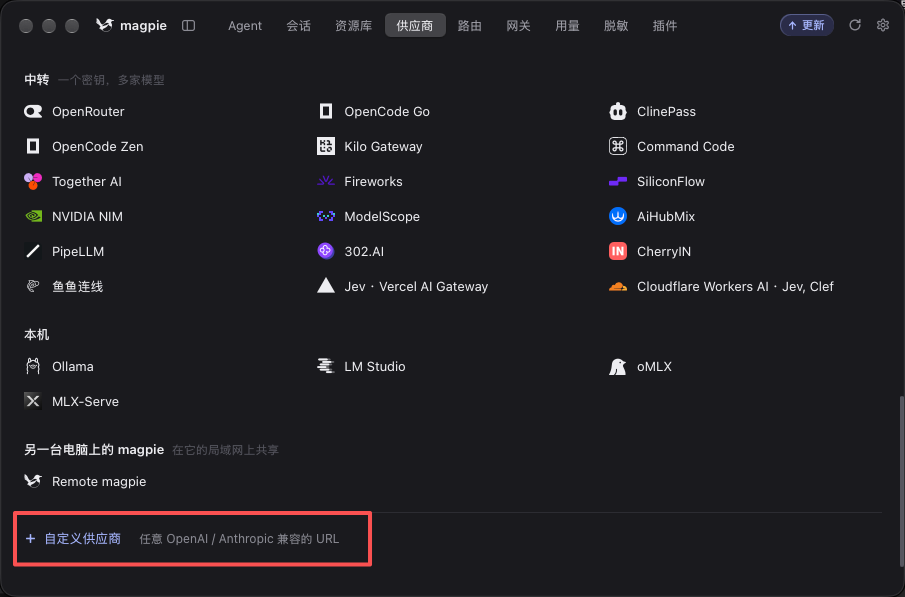
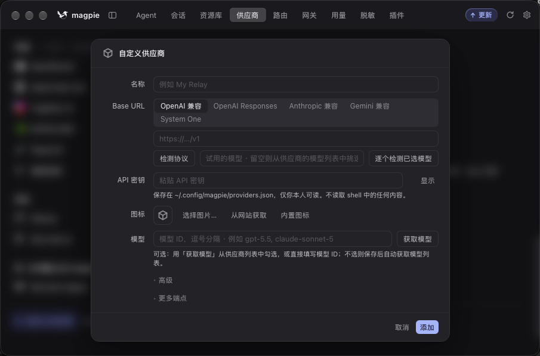
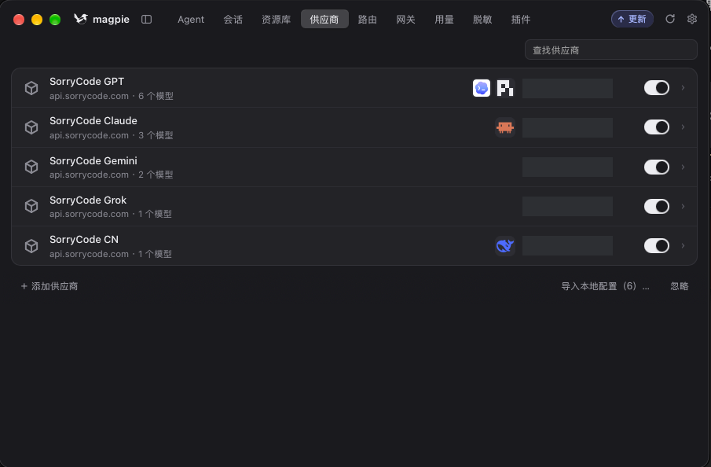

# Configure SorryCode in Magpie

To connect SorryCode in Magpie, add a provider, fetch its models, then choose a model in the Agent panel. Add the API key for each SorryCode model group separately.

## 1. Download and install Magpie

Open the [Magpie website](https://usemagpie.ai/), download the version for your computer, and install it.

## 2. Configure a custom provider for each group

Open the Providers page in Magpie, click **Add Provider**, and choose **Custom Provider**. Magpie also offers presets such as OpenRouter and Ollama; use the custom option for SorryCode.

Create a separate configuration for each SorryCode group. Enter a recognizable name, that group's API key, and the SorryCode main-site URL with `/v1` as the Base URL, for example `https://sorrycode.com/v1`. Choose a compatible API type for the group's models. If unsure, click **Detect Protocol** first. Then click **Fetch Models** and select the models available to that key.

The example uses separate entries named `SorryCode GPT`, `SorryCode Claude`, `SorryCode Gemini`, `SorryCode Grok`, and `SorryCode CN`. Use your own group names and matching keys. Do not use one group's key in another group's configuration.

## 3. Enable a model in the Agent panel

Install the agent you want to use first. If unsure, choose [Codex](/docs/agents/codex). Open the Agent panel and turn on **Connect** for the agent you want to configure. Then choose a provider and model you added. The screenshot shows several agents configured with different models.

If the model does not appear in the agent's list, return to Providers, check that the configuration was saved, and click **Fetch Models** again.

Need a SorryCode API key? See [Create an API Key](/docs/start/create-api-key).

Reopen the target agent after setup, and keep Magpie running while you use it. Other choices: [Claude Code](/docs/agents/claude-code), [DeepSeek Harness](/docs/agents/dsh), [WorkBuddy](/docs/agents/workbuddy), and [Other Agents](/docs/agents/other-agents).
