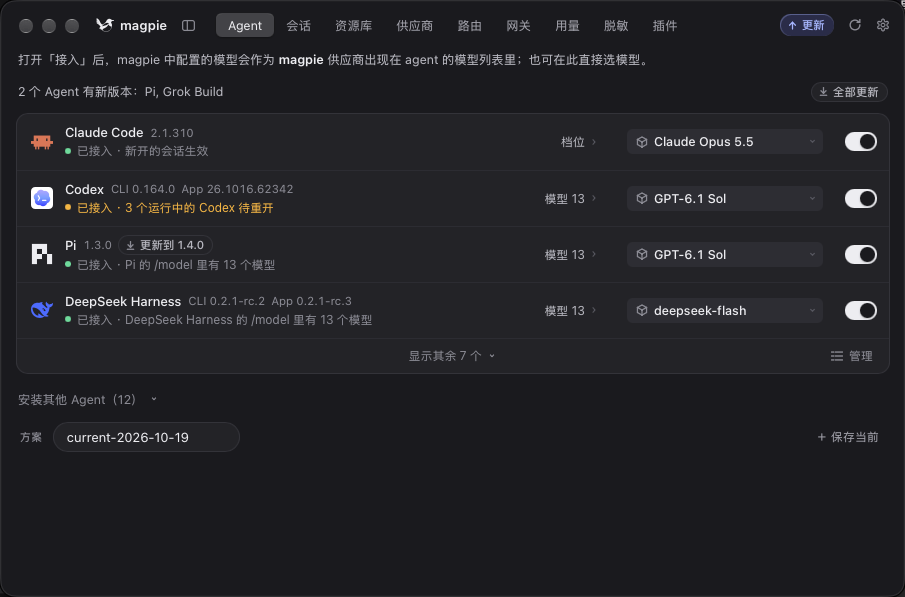

# 用 Magpie 配置 SorryCode

在 Magpie 里接入 SorryCode，只需添加供应商、获取模型，再到 Agent 面板选择模型。不同 SorryCode 分组要分别添加对应的 API Key。

## 1. 下载并安装 Magpie

打开 [Magpie 官网](https://usemagpie.ai/zh/)，下载适合你电脑的版本并完成安装。

## 2. 按分组配置自定义供应商

在「供应商」页面点击「添加供应商」，选择「自定义供应商」。Magpie 也提供 OpenRouter、Ollama 等预设；SorryCode 按下面的自定义方式配置即可。

每个 SorryCode 分组单独添加一项配置。填写容易辨认的名称、对应分组的 API Key，以及 SorryCode 主站地址加 `/v1` 作为 Base URL，例如 `https://sorrycode.com/v1`。接口类型选择与该分组模型兼容的选项；不确定时可以先点「检测协议」。然后点击「获取模型」，从返回列表中选择该 Key 可用的模型。

示例中按分组创建了 `SorryCode GPT`、`SorryCode Claude`、`SorryCode Gemini`、`SorryCode Grok` 和 `SorryCode CN`。名称用于区分配置，实际可用模型仍由所填 Key 所属的分组决定。请使用你自己的分组名称及对应 Key，不要把一组的 Key 用在另一组配置里。

## 3. 在 Agent 面板启用模型

打开 Agent 面板，在目标 Agent 上启用「接入」，再从模型列表中选择刚才添加的供应商和模型。截图示例展示了多个 Agent 使用不同模型的配置。

如果模型没有出现在 Agent 的选择列表里，回到「供应商」检查对应的配置是否已保存，并重新点击「获取模型」。

还没有 SorryCode API Key？请先看[创建 API Key](/docs/start/create-api-key)。
