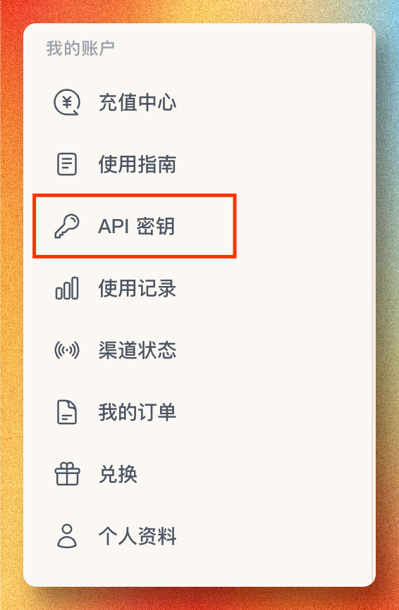
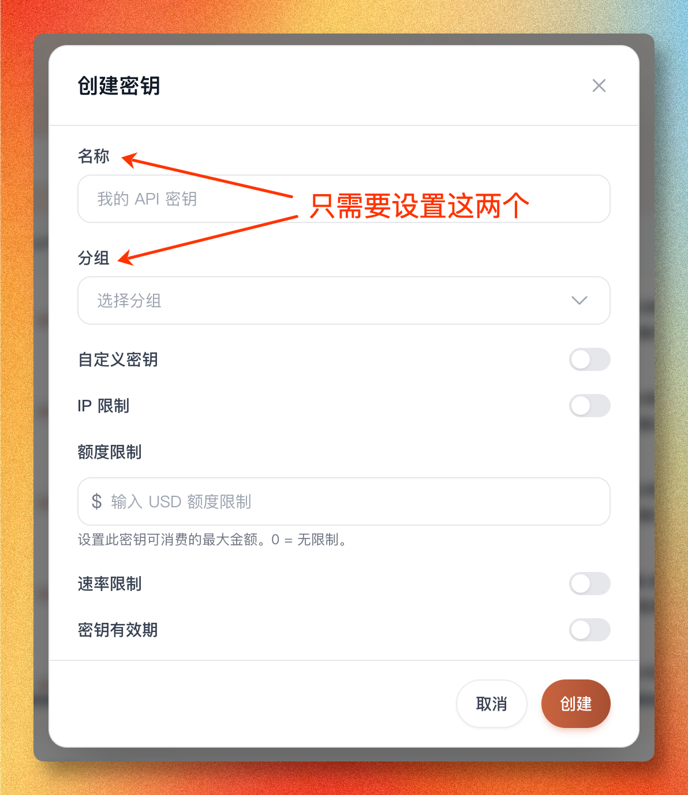
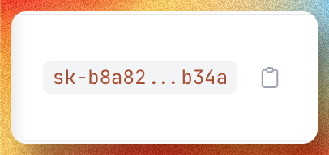
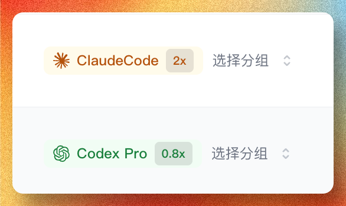

# Create an API Key

An API key identifies the account responsible for model usage and charges. Put it in Magpie after creation, not in chat.

## 1. Open API Keys

Sign in to the [SorryCode console](https://sorrycode.com), confirm that your balance is available, and open **API Keys** in the sidebar. You can also go directly to the [API key list](https://sorrycode.com/keys).

## 2. Create a key and select a group

Create a key, give it a recognizable name such as “Daily work,” and select the model group you need.

The group determines available models and the billing multiplier. Start with one group. If you add more groups in Magpie, prepare a matching key for each.

A spending limit of `0` means no separate limit; set a budget if needed. If unsure about rate limits or expiration, leave the defaults for now.

## 3. Copy it into Magpie

Copy the complete key. Follow [Configure SorryCode in Magpie](/docs/agents/magpie) and paste it into the API Key field of the matching custom provider.

One account balance can serve multiple keys. A key in a compatible group can be shared by several agents; you do not need a new key for every tool. Split keys only when you need separate usage records, limits, or credential rotation.

You can switch a key's group from the list. After switching, check the matching provider configuration in Magpie and fetch models again. Do not mix keys from different groups.

Keep keys out of prompts, public screenshots, and code repositories. If a key leaks, disable or delete it in the console immediately and create a new one.
